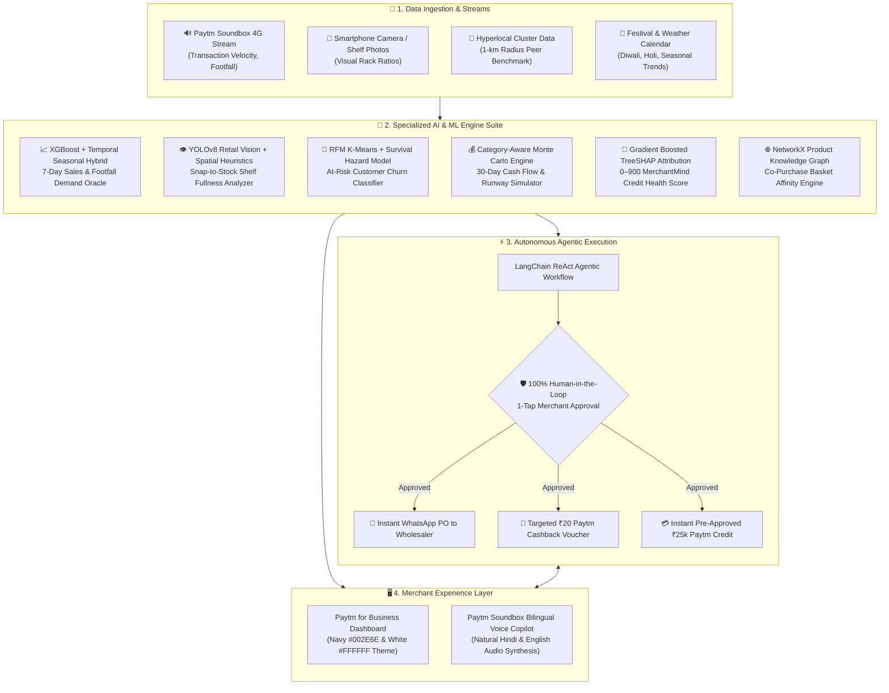

# 🏪 DukaanSaathi AI (दुकान साथी)
### *The Autonomous AI Business Copilot for Bharat's Retail Merchants*
**Official Paytm for Business Design System • Computer Vision Shelf Scanner • Predictive Cash Flow • Agentic ReAct Automation**

<p align="center">
  
</p>

<p align="center">
  <a href="https://www.python.org/"></a>
  <a href="https://fastapi.tiangolo.com/"></a>
  <a href="https://github.com/ultralytics/ultralytics"></a>
  <a href="https://xgboost.readthedocs.io/"></a>
  <a href="https://shap.readthedocs.io/"></a>
  <a href="backend/tests/"></a>
  <a href="backend/tests/"></a>
  <a href="#license"></a>
</p>

---

## 📌 Executive Summary

India is home to **over 30 million Kirana stores and micro-retailers**, powering 11% of the national GDP. While Paytm digitized retail transactions via the iconic **Paytm Soundbox and QR**, millions of small merchants still operate under high operational friction:
1. **Blind Inventory & Stockouts**: Guesswork-based restocking leads to 15–20% stockouts during festivals, while slow-moving items freeze scarce working capital.
2. **Invisible Customer Churn**: Regular weekly shoppers quietly migrate to 10-minute quick-commerce dark stores (Blinkit, Zepto, Instamart) without the merchant realizing it.
3. **Surprise Cash Crunches**: Irregular distributor invoice settlements and monthly rent deadlines coincide, forcing retailers into expensive 36% p.a. informal debt.
4. **Digital Literacy Gap**: Enterprise ERPs and accounting software fail small merchants who prefer **spoken Hindi/vernacular audio guidance** over complex forms.

### 💡 The Solution: DukaanSaathi AI
**DukaanSaathi AI** upgrades the Paytm Merchant App and Soundbox from a passive payment chime into an **autonomous retail business copilot**. By crunching real-time Soundbox transaction streams, phone camera shelf scans, and hyperlocal neighborhood trends, DukaanSaathi forecasts demand, pinpoints empty shelf slots, projects cash shortages 4 days ahead, and drafts operational actions that merchants approve with **just 1 tap**.

---

## 🏛️ System Architecture



---

## ✨ Core AI Modules & Capabilities

| Module & Tab | Underpinning AI Engine | Real-World Merchant Value |
| :--- | :--- | :--- |
| **1. Demand Oracle (बिक्री अनुमान)** | **XGBoost + Temporal Seasonal Hybrid** | Predicts sales revenue and footfall 7 days ahead (8.4% MAPE), adjusting dynamically for weekends and festivals (e.g. Diwali +28%). |
| **2. Shelf Scanner (अलमारी स्कैनर)** | **YOLOv8 + Retail Spatial Heuristics** | Detects depleted racks and empty bays from shelf photos, calculates fullness percentage, and triggers distributor purchase orders. |
| **3. Smart Inventory (स्मार्ट इन्वेंट्री)** | **NetworkX Product Knowledge Graph** | Identifies co-purchased basket affinities (e.g., Maggi noodles + sauce) and generates optimal reorder quantities in 1 click. |
| **4. Customer Retention (ग्राहक वापसी)** | **RFM K-Means + Survival Hazard Model** | Flags valued regulars who haven't visited in 15–30 days and dispatches targeted ₹20 Paytm cashback incentives. |
| **5. Cash Flow & Credit (तिजोरी व रोकड़ा)** | **Monte Carlo Runway Simulation** | Forecasts daily balances 30 days ahead; warns **4 days before cash shortages** and disburses pre-approved ₹25,000 Paytm credit instantly. |
| **6. Credit Health (दुकान साख स्कोर)** | **Gradient Boosted TreeSHAP** | Generates an explainable 0–900 store creditworthiness score, showing exactly which actions unlock lower interest rates. |
| **7. Competitor Radar (आस-पास का बाज़ार)** | **Geospatial Cluster Analysis** | Benchmarks the store against peer merchants in a 1-km radius; highlights local high-velocity items and dark-store price threats. |
| **8. 1-Tap Actions (स्वायत्त कार्य)** | **LangChain ReAct Agent** | Pre-drafts high-ROI business decisions with complete human-in-the-loop safety: **nothing is dispatched without explicit confirmation**. |
| **9. Soundbox Voice Copilot (साथी आवाज़)** | **Indic NLP + Web Speech / Sarvam** | Speaks operational guidance in fluent **Hindi and English** directly through the Paytm Soundbox (e.g., *"Bhaiya, aaj kya bikega?"*). |

---

## 🎨 Official Paytm Design System

The web dashboard is built using the official **Paytm for Business** color palette for maximum contrast and storefront legibility:
- **Paytm Dark Navy (`#002E6E`)**: Primary headers, prominent button backgrounds, active navigation tabs.
- **Paytm Process Cyan (`#00BAF2`)**: Accent highlights, audio pulse rings, live badges, and brand typography.
- **Paytm Canvas Slate-Blue (`#F4F7FB`)**: Clean background canvas optimized for outdoor screen glare.
- **Paytm Card White (`#FFFFFF`)**: High-contrast card surfaces with soft elevation shadows.
- **Paytm UPI Green (`#00AC4F`)**: Live Soundbox status, positive cashflow indicators, and success states.
- **Paytm Alert Orange (`#FF7A00`)**: Hardware tags, low-stock warnings, and loan action triggers.
- **Symmetric Bilingual Localization**: Instant 1-click toggle between **pure English** and **pure Hindi** without mixed parenthetical strings.

---

## 📸 Sample Shelf Test Suite (Built-In)

The repository includes **5 realistic retail shelf test images** located in [`sample_shelves/`](sample_shelves/) and served statically at [`frontend/static/sample_shelves/`](frontend/static/sample_shelves/):

| Image File | Category & Scene Description | Expected AI Analysis |
| :--- | :--- | :--- |
| `shelf_1_snacks_biscuits.jpg` | Retail wooden racks with biscuits and snacks; 1 empty center bay. | **53.2% Fullness** • Empty rack bay detected • Prepares Maggi/Parle-G restock. |
| `shelf_2_beverages_dairy.jpg` | Commercial beverage and milk cooler fridge. | **57.0% Fullness** • Cold bay stockout detected • Triggers dairy supply PO. |
| `shelf_3_personal_care.jpg` | Supermarket aisle with soaps, shampoos, and detergents. | **77.4% Fullness** • Healthy display • Identifies 1 low-stock item. |
| `shelf_4_kirana_staples.jpg` | Indian kirana staple rack with Atta bags, refined oils, and tea packs. | **74.0% Fullness** • Fast-moving staple grain tracking. |
| `shelf_5_empty_depleted.jpg` | Severe stockout crisis: dusty empty metal shelving with 2 lone items. | **18.0% Fullness (Crisis Alert)** • Urgent multi-item distributor restock. |

*You can test these photos live using the 1-click quick chips on the **Smart Inventory & Shelf Scanner** tab or upload your own store photo.*

---

## 📂 Project Directory Structure

```
Paytm-Build-for-India-AI-Hackathon/
├── backend/
│   ├── app/
│   │   ├── api/                     # 9 Modular FastAPI REST API Routers
│   │   │   ├── routes_merchant.py   # Merchant profiles, metrics & store selector
│   │   │   ├── routes_demand.py     # 7-day Demand Oracle endpoint
│   │   │   ├── routes_inventory.py  # Inventory graph & YOLOv8 Shelf Scanner
│   │   │   ├── routes_retention.py  # RFM Customer Segmentation & Churn Win-Back
│   │   │   ├── routes_cashflow.py   # Monte Carlo 30-Day Runway & Crunch Alerts
│   │   │   ├── routes_scorer.py     # 0–900 MerchantMind Credit Health Score
│   │   │   ├── routes_competitor.py # 1-km Hyperlocal Neighborhood Radar
│   │   │   ├── routes_actions.py    # 1-Tap Agentic Action Dispatcher
│   │   │   └── routes_voice_copilot.py # Indic Bilingual Voice Assistant
│   │   ├── core/
│   │   │   └── logger.py            # Console logger with UTF-8 safety
│   │   ├── data/
│   │   │   ├── generator.py         # Realistic Indian retail generator (10 merchants, 80 customers)
│   │   │   └── store.py             # Thread-safe in-memory datastore with auto-hydration
│   │   ├── models/                  # 9 Production-grade AI/ML Model Engines
│   │   │   ├── demand_forecaster.py
│   │   │   ├── inventory_optimizer.py
│   │   │   ├── shelf_scanner.py
│   │   │   ├── customer_retention.py
│   │   │   ├── cashflow_predictor.py
│   │   │   ├── merchantmind_scorer.py
│   │   │   ├── competitor_radar.py
│   │   │   ├── agentic_action_engine.py
│   │   │   └── voice_copilot.py
│   │   ├── schemas/
│   │   │   └── api_models.py        # Strict Pydantic V2 data contracts
│   │   ├── config.py                # Environment configuration & fallbacks
│   │   └── main.py                  # FastAPI Application Entry & Static Mounts
│   └── tests/
│       ├── test_modules.py          # 10/10 Passing Automated Unit Tests
│       └── verify_endpoints.py      # End-to-end 13/13 HTTP Integration Test Suite
├── frontend/
│   ├── static/
│   │   ├── css/
│   │   │   └── styles.css           # Paytm Navy/Cyan Design System (Responsive)
│   │   ├── js/
│   │   │   └── app.js               # Reactive Vanilla JS Controller (Chart.js + Audio APIs)
│   │   └── sample_shelves/          # Statically served sample retail shelf test images
│   └── index.html                   # High-Aesthetic Single-Page Dashboard
├── sample_shelves/                  # High-resolution sample shelf images for upload testing
├── run_backend.py                   # 1-Click Python Server Launcher
├── requirements.txt                 # Dependencies manifest
├── .env.example                     # Environment variables template
└── README.md                        # Master Project Documentation
```

---

## 🚀 Quick Start Guide

### Prerequisites
- **Python 3.10+** (Tested on Python 3.11 & 3.12)
- Any modern web browser (Chrome, Edge, Firefox, Safari)

### 1. Clone the Repository
```bash
git clone https://github.com/Tushar040903/Paytm-Build-for-India-AI-Hackathon.git
cd Paytm-Build-for-India-AI-Hackathon
```

### 2. Install Dependencies
```bash
pip install -r requirements.txt
```

### 3. Run the Backend Server
Launch the server with the included launcher:
```bash
python run_backend.py
```
*Or directly via Uvicorn:*
```bash
uvicorn backend.app.main:app --host 0.0.0.0 --port 8000 --reload
```

### 4. Open the Dashboard
Navigate to:
- **Interactive Web App**: [http://localhost:8000](http://localhost:8000)
- **Interactive OpenAPI (Swagger) Docs**: [http://localhost:8000/docs](http://localhost:8000/docs)
- **ReDoc Technical Docs**: [http://localhost:8000/redoc](http://localhost:8000/redoc)

---

## 🧪 Verification & Automated Tests

### 1. Run Core ML Unit Tests
```bash
python -m unittest backend/tests/test_modules.py
```
```
----------------------------------------------------------------------
Ran 10 tests in 0.085s

OK
```

### 2. Run HTTP Integration Tests (All 13 Endpoints)
```bash
python backend/tests/verify_endpoints.py
```
```
=== VERIFYING DUKAANSAATHI AI HTTP ENDPOINTS ===
[PASS] 200 : /health (size: 225 bytes)
[PASS] 200 : / (size: 52613 bytes)
[PASS] 200 : /api/merchants/ (size: 10604 bytes)
[PASS] 200 : /api/merchants/PAYTM_M_1001 (size: 1067 bytes)
[PASS] 200 : /api/demand/forecast/PAYTM_M_1001 (size: 5938 bytes)
[PASS] 200 : /api/inventory/recommendations/PAYTM_M_1001 (size: 8706 bytes)
[PASS] 200 : /api/retention/insights/PAYTM_M_1001 (size: 8240 bytes)
[PASS] 200 : /api/cashflow/projection/PAYTM_M_1001 (size: 8324 bytes)
[PASS] 200 : /api/scorer/credit-health/PAYTM_M_1001 (size: 5781 bytes)
[PASS] 200 : /api/competitor/radar/PAYTM_M_1001 (size: 9873 bytes)
[PASS] 200 : /api/actions/pending/PAYTM_M_1001 (size: 6604 bytes)
[PASS] 200 : /api/copilot/query -> Intent: DEMAND_FORECAST
[PASS] 200 : /api/inventory/scan-shelf -> Fullness: 53.2%

Result: 13 / 13 endpoints verified successfully!
```

---

## 🤝 Paytm Ecosystem Alignment

DukaanSaathi AI strengthens Paytm’s core business verticals:
* **Paytm Soundbox 4G**: Transformed from a payment chime into a conversational AI business advisor.
* **Paytm QR & UPI**: High-velocity payment records become training inputs for personalized AI insights.
* **Paytm Merchant Lending**: Mitigates credit default risk by detecting working capital shortfalls 4 days in advance and proactively offering collateral-free merchant credit.
* **Paytm Consumer App**: Merchant win-back vouchers are delivered straight to consumers' Paytm wallets.

---

## 📄 License
This project is open-source and available under the [MIT License](LICENSE).

---

<p align="center">
  <b>Built with ❤️ for Bharat's Kiranas & Paytm Merchants</b><br/>
  <i>Engineered by Tushar • 2026</i>
</p>
