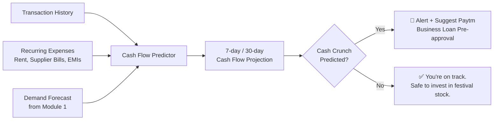

# 🔥 MerchantMind AI — Enhanced Plan: 6 Game-Changing Additions

> [!NOTE]
> These are **new enhancements** on top of the original 4-module plan. These go beyond your existing portfolio and add genuinely novel capabilities that will make evaluators say *"nobody else thought of this."*

---

## 🆕 Enhancement 1: Voice-First AI — Speech-to-Speech Merchant Copilot

### Why This Changes Everything

Most Paytm merchants in Tier 2/3/4 cities are **not comfortable typing**. Many are semi-literate or have low digital literacy. A text chatbot, no matter how smart, creates friction.

**The fix:** MerchantMind AI becomes a **voice assistant** — the merchant simply **speaks** into their phone in Hindi, Marathi, Tamil, or any regional language, and **hears back** actionable advice in the same language.

### How It Works

```
Merchant speaks in Hindi
        ↓
Sarvam AI Speech-to-Text (Indic ASR)
        ↓
LangChain Agent processes intent
        ↓
Gemini generates response
        ↓
Sarvam AI Text-to-Speech (Indic TTS)
        ↓
Merchant HEARS the response
```

### Example Interaction

> **Merchant (speaks):** *"Aaj ki bikri kaisi rahi?"*
>
> **MerchantMind (speaks back):** *"Tushar ji, aaj aapki total bikri ₹8,450 rahi, jo kal se 12% zyada hai. Sabse zyada bika Parle-G aur Amul doodh. Kal barish ka forecast hai, toh chai patti aur samosa ka stock rakh lijiye — pichle barish wale din aapki bikri 35% badhi thi."*

### Why Evaluators Will Love This

- **Accessibility play** — Targets the 60%+ merchants who can't use text-based tools effectively
- **Uses Sarvam AI's ASR + TTS** — directly showcases the hackathon sponsor's technology
- **No competitor offers this** — PhonePe, Google Pay have zero voice-based merchant intelligence
- **India-specific insight** — Voice is the natural interface for Bharat, not text

### Tech: Sarvam AI Bulbul/Saaras models for ASR & TTS + WebSocket streaming for real-time voice

---

## 🆕 Enhancement 2: 📸 Camera-Based Shelf Scanning — "Snap to Stock"

### Why This Is Novel

Inventory tracking is the #1 pain point for small merchants, but **no small merchant uses inventory management software**. It's too complex. 

**The fix:** The merchant simply **takes a photo of their shelf/rack** with their phone camera. The AI vision model:
- Identifies products on the shelf
- Estimates stock levels (full, half, low, empty)
- Compares against predicted demand
- Generates instant restock alerts

### How It Works

```
📸 Merchant takes shelf photo
         ↓
YOLO Object Detection → identify products
         ↓
Volume Estimation → stock level per product
         ↓
Compare vs. Demand Oracle forecast
         ↓
🔔 "Maggi is at 20% stock. 
    Predicted demand: 45 units this week. 
    Reorder 3 cartons by tomorrow."
```

### Example Flow

> **Merchant snaps a photo of their snacks shelf**
>
> **MerchantMind AI responds:**
> - ✅ Lay's Classic — Well stocked (80%)
> - ⚠️ Maggi — Low stock (20%) — **Reorder 3 cartons** (high demand expected, weekend + school holidays)
> - ❌ Kurkure — Empty — **Critical: You lost ~₹800 in sales last time this went out of stock**
> - 💡 **Suggestion:** Add Bingo Mad Angles — 3 nearby kiranas started stocking it and saw 18% snack revenue increase

### Why Evaluators Will Love This

- **Zero-friction inventory tracking** — no manual data entry, no barcode scanners, just a photo
- **Bridges the physical-digital gap** — AI sees the real world through the merchant's camera
- **Computer Vision + ML hybrid** — technically impressive, not just an LLM wrapper
- **You have YOLO expertise** (research paper!) but this is a completely new application domain

### Tech: YOLOv8/YOLO11 fine-tuned on Indian retail shelf images + volume heuristics + Gemini Vision for product recognition

---

## 🆕 Enhancement 3: 💰 Predictive Cash Flow Engine — "Will I Have Enough Money Next Week?"

### Why This Matters

Small merchants live **paycheck to paycheck**. They have no visibility into:
- When they'll face a cash crunch (rent due + supplier payment + low sales week)
- Whether they can afford to stock up for a festival
- If they should take a small business loan NOW vs. later

**No existing fintech product offers cash flow prediction for small merchants.**

### How It Works



### Example Nudge

> *"💰 Tushar ji, based on your sales trend and upcoming payments (₹15,000 rent on 5th + ₹8,000 supplier bill on 7th), you may face a ₹6,000 shortfall next week. Options: (1) Apply for Paytm Instant Loan at 1.2% — pre-approved for ₹25,000 (2) Delay supplier order by 3 days to align with your peak sales period."*

### Why Evaluators Will Love This

- **Directly drives Paytm Lending revenue** — this is a natural cross-sell Paytm cares deeply about
- **Financial planning for the underserved** — consultants charge ₹10K+/month for this; AI gives it free
- **Predictive, not reactive** — warns BEFORE the crunch happens
- **Novel application** — no competitor does merchant-level cash flow forecasting

### Tech: Time-series regression on cash inflows/outflows + recurrence detection for periodic expenses + Monte Carlo simulation for confidence intervals

---

## 🆕 Enhancement 4: 📊 MerchantMind Score — AI-Generated Merchant Credit Score

### The Big Idea

Banks and NBFCs struggle to assess creditworthiness of small merchants (thin credit files). Paytm has **rich transaction data** that can power a proprietary credit score.

**MerchantMind Score** is a 0-900 score that evaluates merchant health across 5 dimensions:

| Dimension | Weight | Signals |
|---|---|---|
| **Revenue Consistency** | 25% | Monthly revenue variance, growth trend, seasonality stability |
| **Customer Loyalty** | 20% | Repeat customer %, customer lifetime value, churn rate |
| **Transaction Diversity** | 15% | Multiple payment modes, avg. ticket size range, peak/off-peak balance |
| **Growth Velocity** | 25% | Month-over-month growth rate, peer benchmarking percentile |
| **Digital Maturity** | 15% | Paytm feature adoption, QR usage, Postpaid acceptance, app engagement |

### How It Benefits the Ecosystem

```
High MerchantMind Score (750+)
    → Pre-approved Paytm Business Loan at lower interest
    → Priority merchant support
    → Featured in "Trusted Merchants" on Paytm consumer app
    → Higher Paytm Ads visibility

Low Score (below 400)
    → AI identifies exact areas dragging score down
    → Personalized improvement plan
    → "Increase your score by 80 points: Accept Paytm Postpaid 
       and maintain consistent daily transactions for 30 days"
```

### Why Evaluators Will Love This

- **Creates a NEW financial product** for Paytm — merchant creditworthiness as a service
- **Revenue multiplier** — better risk scoring = more lending = more interest revenue for Paytm
- **Gamification + credit** — merchants are motivated to improve their score (like CIBIL for businesses)
- **Data moat** — only Paytm has this transaction depth; PhonePe/Google Pay can't replicate it

### Tech: Gradient Boosted scoring model (XGBoost) + SHAP explainability for transparent score breakdowns

---

## 🆕 Enhancement 5: 🗺️ Hyperlocal Competitor Radar — "What's Working for Shops Around You?"

### The Concept

Merchants are always curious about what their competitors are doing. MerchantMind AI provides **anonymized, aggregated** competitive intelligence from nearby merchants in the same category:

### What Merchants See

> **📊 Your Neighborhood Pulse (Sector 62, Noida — Kirana Stores)**
>
> - 🔥 **Trending This Week:** Organic atta demand up 34% in your area
> - 📈 **Top 10% kiranas near you** average ₹1.2L/month. You're at ₹68K. Gap areas: dairy products, ready-to-eat snacks
> - 💡 **New Opportunity:** 2 kiranas near you added home delivery via Paytm and saw 22% revenue jump
> - ⚠️ **Alert:** A new supermarket opened 1.2 km away. Kiranas within 500m of supermarkets typically see 15% dip initially but recover in 3 months if they focus on convenience + personal service

### Why Evaluators Will Love This

- **Network effect** — more merchants on MerchantMind = better intelligence for everyone = stickiness
- **Anonymized and ethical** — no individual merchant data is exposed, only aggregated trends
- **Drives FOMO-based adoption** — "your competitor is growing faster" is the strongest motivation
- **Creates a data flywheel** that gets more valuable over time

### Tech: Geospatial clustering (H3 hexagonal grid) + privacy-preserving aggregation + trend detection using z-score anomaly detection on category-level transaction data

---

## 🆕 Enhancement 6: 🤖 Agentic Actions — AI That Doesn't Just Suggest, It ACTS

### The Key Differentiator

Most AI tools are **advisory** — they tell you what to do. MerchantMind AI takes it further with **agentic autonomous actions** (with merchant permission):

### Actions the AI Can Take

| Action | How It Works | Merchant Control |
|---|---|---|
| **Auto-Reorder from Suppliers** | AI detects low stock → sends WhatsApp message to saved supplier contact with order details | Merchant approves via one-tap confirmation |
| **Send Customer Win-back Offers** | AI detects churning customer → sends ₹20 cashback offer via Paytm notification | Merchant sets budget cap (e.g., ₹500/month max) |
| **Dynamic Price Updates** | AI suggests price change for perishable items approaching expiry → updates digital price display | Merchant approves or auto-approves within ±10% range |
| **Schedule Social Media Posts** | AI generates "Today's Special" post with product photo → posts to merchant's WhatsApp Status/Instagram | Merchant reviews and posts with one tap |
| **Auto-Apply for Paytm Loans** | Cash crunch predicted → AI pre-fills loan application → merchant just confirms | Requires explicit opt-in |

### Example Flow

```
🤖 MerchantMind AI:
"Your Amul Butter stock will run out by Wednesday. 
I've prepared an order for 2 cartons from Sharma Distributors. 
Shall I send it via WhatsApp?"

   [✅ Send Order]    [✏️ Modify]    [❌ Skip]
```

### Why Evaluators Will Love This

- **Aligns with Track 3's philosophy** ("AI teammates that get the job done") applied to Track 1 context
- **Moves from analytics to autonomy** — the most advanced tier of AI maturity
- **Practical agentic AI** — not theoretical, each action is simple and reversible
- **Human-in-the-loop safety** — merchant always has final approval (one-tap, not complex)

### Tech: LangChain ReAct agents + tool-use pattern + WhatsApp Business API + Paytm Merchant API integration

---

## 📋 Updated Architecture with All Enhancements

```
┌──────────────────────────────────────────────────────────────┐
│                     MerchantMind AI v2.0                     │
│                                                              │
│  ┌─────────────────────────────────────────────────────────┐ │
│  │     🎤 Voice-First Interface (Sarvam AI ASR + TTS)      │ │
│  │     📸 Camera Shelf Scanning (YOLO + Gemini Vision)     │ │
│  └─────────────────────────────────────────────────────────┘ │
│                                                              │
│  ┌──────────┬──────────┬──────────────┬───────────────────┐  │
│  │ Module 1 │ Module 2 │   Module 3   │    Module 4       │  │
│  │ Demand   │ Smart    │  Customer    │  Growth Path      │  │
│  │ Oracle   │Inventory │  Retention   │  Navigator        │  │
│  │   AI     │   AI     │     AI       │     AI            │  │
│  ├──────────┼──────────┼──────────────┼───────────────────┤  │
│  │     NEW: │   NEW:   │    NEW:      │     NEW:          │  │
│  │ Cash Flow│  Shelf   │  Competitor  │  MerchantMind     │  │
│  │ Predictor│  Scanner │    Radar     │    Score          │  │
│  └──────────┴──────────┴──────────────┴───────────────────┘  │
│                                                              │
│  ┌─────────────────────────────────────────────────────────┐ │
│  │     🤖 Agentic Actions Layer (Auto-Execute with         │ │
│  │        merchant approval: reorder, offers, pricing)     │ │
│  └─────────────────────────────────────────────────────────┘ │
│                                                              │
│  ┌─────────────────────────────────────────────────────────┐ │
│  │              Paytm Transaction Data Layer               │ │
│  └─────────────────────────────────────────────────────────┘ │
└──────────────────────────────────────────────────────────────┘
```

---

## 🎯 Updated Tech Stack Additions

| New Component | Technology | Novelty Factor |
|---|---|---|
| **Voice AI** | Sarvam AI Bulbul (ASR) + Saaras (TTS) + WebSockets | 🔥 Not in your portfolio — new skill |
| **Shelf Scanning** | YOLO11 + Gemini Vision API | 🔥 New application of your YOLO expertise |
| **Cash Flow Prediction** | Monte Carlo Simulation + Recurrence Detection | 🔥 Financial modeling — new domain |
| **Credit Scoring** | XGBoost + SHAP Explainability | ⚡ Extension of existing skills to fintech |
| **Competitor Radar** | H3 Geospatial Indexing + Z-Score Anomaly Detection | 🔥 Geospatial analytics — new skill |
| **Agentic Actions** | LangChain ReAct + Tool Use + WhatsApp Business API | 🔥 Autonomous AI — beyond advisory |

---

## 🏆 Final Impact: What Makes This UNBEATABLE

| Aspect | Before (Original Plan) | After (Enhanced Plan) |
|---|---|---|
| **Interface** | Text chatbot | **Voice-first** + text + camera input |
| **Inventory Tracking** | Manual data input | **Snap a photo** → instant stock analysis |
| **Financial Intelligence** | Revenue analytics only | **Cash flow prediction + credit scoring** |
| **Competitive Intel** | None | **Hyperlocal competitor radar** |
| **AI Maturity** | Advisory (suggests) | **Agentic (acts with permission)** |
| **Accessibility** | Literate merchants only | **Semi-literate merchants via voice** |
| **Paytm Revenue Impact** | Indirect (GMV growth) | **Direct (lending, scoring, ads)** |

> [!TIP]
> **For the PPT:** You don't need to go deep into all 6 enhancements. Pick the **top 3 that resonate most** (I'd recommend **Voice AI + Shelf Scanning + Agentic Actions**) and present them as hero features. Mention the others as "additional capabilities" on a single slide.

---

## 🎬 Recommended PPT Slide Order (7 slides)

1. **Title Slide** — MerchantMind AI: The AI Business Copilot for Every Paytm Merchant
2. **Problem Statement** — The data goldmine merchants can't see (stats + emotional hook)
3. **Solution Overview** — 4 modules + 3 hero enhancements (architecture diagram)
4. **Live Demo Scenario** — Walk through one merchant's day with MerchantMind (voice query → demand forecast → shelf scan → auto-reorder)
5. **Tech Stack** — Architecture diagram + why each choice (highlight Sarvam AI)
6. **Impact + Business Model** — Revenue projections + Paytm ecosystem synergy
7. **USP + Why Us** — Competitive comparison + team strengths + "we've already built every component"
