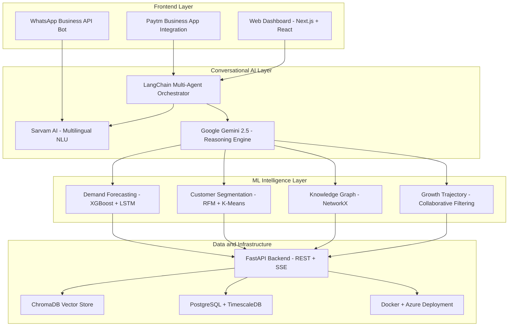
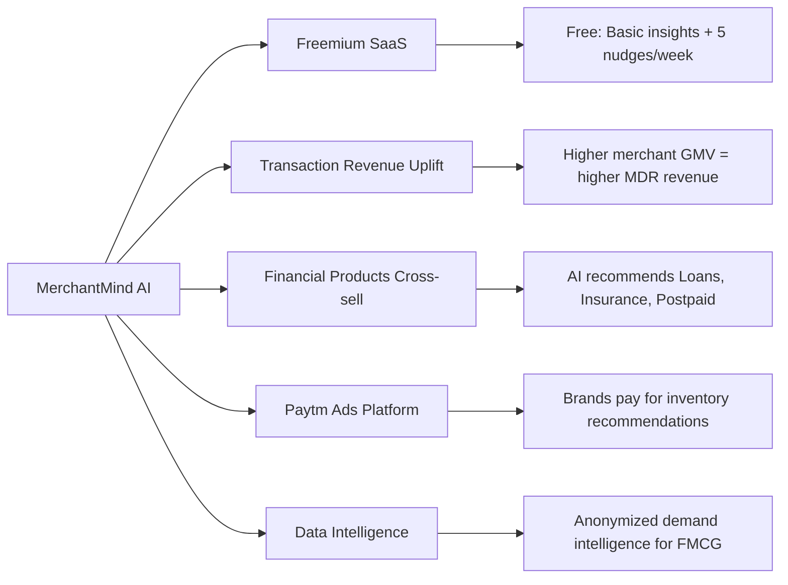

# 🚀 Paytm Build for India AI Hackathon — Track 1: Merchant Growth AI

## **Project Name: MerchantMind AI — The AI Business Copilot for Paytm Merchants**

---

## 📌 Title Slide Summary

**MerchantMind AI** is an AI-powered business intelligence copilot that transforms every Paytm merchant's transaction data into actionable growth strategies — delivering hyper-local demand forecasting, smart inventory nudges, dynamic pricing recommendations, and customer retention playbooks — all through a conversational AI interface accessible via the Paytm for Business app.

---

## 🔴 Problem Statement

### The Merchant Reality in India

India has **30+ million** merchants on Paytm's ecosystem. The vast majority are **small and micro-merchants** — kirana stores, street food vendors, local service providers, small retailers — who face critical business challenges:

| Problem | Impact |
|---|---|
| **Zero Data Literacy** | 85%+ merchants can't interpret their own sales patterns, seasonal trends, or customer behavior |
| **Blind Inventory Management** | Overstocking leads to ~₹32,000 Cr annual waste in Indian retail; understocking loses ₹15,000 Cr in missed sales |
| **No Demand Forecasting** | Merchants rely on gut feel, miss hyper-local demand spikes (festivals, events, weather changes) |
| **Customer Churn Invisibility** | No way to know which regular customers are slipping away or how to bring them back |
| **Pricing Guesswork** | No data-driven approach to pricing, competitor awareness, or discount optimization |
| **No Growth Roadmap** | No structured path from ₹10K/month to ₹1L/month — merchants plateau without knowing why |

### Why This Matters to Paytm

- **Merchant retention** directly correlates with merchant revenue growth — growing merchants stay on Paytm
- Every ₹1 increase in merchant GMV generates direct revenue for Paytm's ecosystem
- **Merchant churn costs 5-7x** more than retention
- AI-driven merchant growth creates a **competitive moat** no other fintech has

> **The Core Insight:** Paytm already sits on the richest merchant transaction dataset in India. The problem isn't data — it's that this goldmine is **invisible to the merchants who generate it.** MerchantMind AI makes this data speak in the merchant's language.

---

## 💡 Proposed Solution: MerchantMind AI

### Architecture: 4-Module AI Copilot System

MerchantMind AI is a **multi-agent AI system** with 4 specialized intelligence modules, unified by a conversational interface:

```
┌──────────────────────────────────────────────────────────┐
│                   MerchantMind AI                        │
│              Conversational AI Interface                 │
│        (Hindi/English/Regional Language NLU)             │
├──────────┬──────────┬──────────────┬─────────────────────┤
│  Module 1│  Module 2│   Module 3   │      Module 4       │
│  Demand  │  Smart   │   Customer   │    Growth Path      │
│  Oracle  │ Inventory│   Retention  │     Navigator       │
│    AI    │   AI     │      AI      │        AI           │
├──────────┴──────────┴──────────────┴─────────────────────┤
│              Paytm Transaction Data Layer                │
│    (Payment history, merchant profiles, location data,   │
│     category data, seasonal patterns, event calendar)    │
└──────────────────────────────────────────────────────────┘
```

---

### 🧠 Module 1: Demand Oracle AI — *"What will sell tomorrow?"*

**What it does:** Predicts hyper-local demand at the individual merchant level, factoring in:

- **Temporal patterns:** Day-of-week, time-of-day, payday cycles, month-end patterns
- **Seasonal intelligence:** Festival calendars (Diwali, Eid, Navratri, local melas), wedding season, exam season
- **Weather-aware forecasting:** Rain → umbrella/chai demand spikes; heatwave → cold drinks/ice cream
- **Event-driven signals:** IPL match days, school reopenings, local events, government holidays
- **Neighborhood-level signals:** What's trending in nearby merchants of the same category

**Example Nudge (Push Notification):**
> *"🎯 Tushar ji, Navratri starts in 3 days. Last year, merchants like you saw 47% more UPI transactions on fasting food items. Consider stocking sabudana, kuttu atta, and fruits. Your nearby competitor added these and saw ₹12,000 extra revenue."*

**ML Approach:**
- Time-series forecasting using **XGBoost + LSTM hybrid** with temporal feature engineering
- Lag features (t-1 to t-7), rolling statistics, cyclical encodings (hour, day, month)
- Hyper-local clustering using **Haversine spatial features** and merchant category embeddings
- Target MAPE: < 12% for 7-day forecasts

---

### 📦 Module 2: Smart Inventory AI — *"What to stock, how much, when?"*

**What it does:** Converts demand forecasts into concrete inventory recommendations:

- **Stock-level recommendations** based on predicted demand + safety stock calculations
- **Dead stock alerts:** Items that haven't sold in X days → suggest discounting or removal
- **Complementary product suggestions** using purchase-pattern knowledge graphs
- **Supplier timing optimization:** When to reorder based on lead times and demand cycles

**Example Nudge:**
> *"📦 Your Maggi stock typically runs out by Thursday. Based on this week's demand forecast, order 3 extra cartons by Tuesday. Auto-remind your supplier?"*

**ML Approach:**
- **Knowledge Graph** (like your SmartCart AI) mapping product co-purchase patterns
- Safety stock optimization using demand variance + lead time modeling
- ABC-XYZ inventory classification using transaction frequency × revenue contribution

---

### 👥 Module 3: Customer Retention AI — *"Who's leaving and how to bring them back?"*

**What it does:** Identifies customer behavior patterns from anonymized transaction data:

- **Customer Segmentation:** Champions, Loyalists, At-Risk, Lost customers (RFM Analysis)
- **Churn Prediction:** Flag regular customers whose visit frequency is declining
- **Win-back Strategies:** Auto-generate targeted offers (cashback, discounts) for at-risk customers
- **Footfall Heatmaps:** Peak hours visualization — optimize staffing and stock readiness

**Example Nudge:**
> *"⚠️ 12 of your regular customers (who visited 3+ times/month) haven't transacted in 15 days. Send them a ₹20 cashback offer via Paytm? Similar merchants recovered 34% of lapsed customers this way."*

**ML Approach:**
- **RFM (Recency, Frequency, Monetary)** segmentation with K-Means clustering
- **Survival analysis** (Cox Proportional Hazard) for churn timeline prediction
- **Uplift modeling** for optimal discount/cashback sizing (maximize ROI of offers)

---

### 🗺️ Module 4: Growth Path Navigator AI — *"Your personalized roadmap from ₹10K to ₹1L/month"*

**What it does:** Creates a personalized, milestone-based growth plan:

- **Benchmark against peers:** "You're in the top 35% of kirana stores in your area. Here's what the top 10% do differently."
- **Actionable weekly missions:** "This week: Activate QR display at billing counter → merchants who did this saw 22% more UPI payments"
- **Paytm product adoption nudges:** "Enable Paytm Postpaid acceptance → access 40% more customer base"
- **Revenue milestone celebrations:** Gamified growth with badges and rewards

**Example Nudge:**
> *"🏆 Congratulations! You crossed ₹50,000 monthly transactions! You're now a Silver Merchant. Unlock: Paytm Business Loan pre-approval up to ₹2L. Next milestone: ₹75,000 → Gold Merchant with priority support."*

**ML Approach:**
- **Collaborative filtering** on merchant growth trajectories to identify success patterns
- **Causal inference** (A/B testing framework) to measure impact of recommendations
- **Multi-armed bandit** for optimal nudge timing and frequency

---

## 🏗️ Technology / Tech Stack



### Stack Breakdown

| Layer | Technology | Why This Choice |
|---|---|---|
| **AI Orchestration** | LangChain + Multi-Agent Architecture | Proven in our Multi-Agent Research System; enables specialized agents per module |
| **LLM Backbone** | Google Gemini 2.5 + Sarvam AI | Gemini for reasoning; **Sarvam AI for Indic language support** (aligns with hackathon's AI partner) |
| **Demand Forecasting** | XGBoost + LSTM | Proven stack from our ParkWise AI project (8.2% MAPE achieved) |
| **Knowledge Graphs** | NetworkX | Proven in SmartCart AI (133 nodes, 393 edges); scales for product relationships |
| **Vector Search** | ChromaDB + HuggingFace Embeddings | Proven in SmartHire AI; enables semantic search over merchant insights |
| **Backend** | FastAPI (REST + SSE Streaming) | Real-time streaming responses; proven in Multi-Agent Research System |
| **Frontend** | Next.js + React Dashboard | Rich interactive visualizations for merchant insights |
| **Deployment** | Docker + Azure | Production-grade containerized deployment |
| **Database** | PostgreSQL + TimescaleDB | Time-series optimized for transaction data |

> **🔑 Strategic Note on Sarvam AI:** Since Sarvam AI is the official AI partner offering ₹5,000 credits for top teams, we integrate Sarvam AI's multilingual models for **Hindi-first conversational AI** — critical for Tier 2/3 merchant adoption. This gives us both a technical edge AND aligns with hackathon sponsor expectations.

---

## 🎯 USP (Unique Selling Proposition)

### What Makes MerchantMind AI Different?

| Differentiator | Details |
|---|---|
| **🗣️ Hindi-First Conversational AI** | Not a dashboard merchants won't use. A chatbot that speaks their language — literally. "Bhaiya, aaj kya sell hoga?" → AI responds with actionable insights in Hindi |
| **🌦️ Hyper-Local Context Awareness** | Combines weather + festivals + local events + neighborhood trends. No other solution does this at the individual merchant level |
| **🧠 Multi-Agent Architecture** | 4 specialized AI agents collaborate — not a monolithic model. Each agent is expert in its domain |
| **📊 Knowledge Graph Recommendations** | Product co-purchase graphs enable "merchants who sold X also stocked Y" intelligence |
| **🎮 Gamified Growth Path** | Milestone-based progression keeps merchants engaged. Proven engagement pattern from gaming/edtech |
| **💰 Direct Revenue Attribution** | Every recommendation is tracked for ROI — merchants see "AI suggested X → you earned ₹Y extra" |
| **🔄 Paytm Ecosystem Synergy** | Naturally drives adoption of Paytm Postpaid, Paytm Business Loans, Paytm Ads — increasing Paytm's own revenue |

### Competitive Edge vs. Existing Solutions

| Feature | Traditional POS Analytics | Generic AI Chatbots | **MerchantMind AI** |
|---|---|---|---|
| Hyper-local demand forecasting | ❌ | ❌ | ✅ |
| Multilingual conversational | ❌ | Partial | ✅ (Sarvam AI) |
| Weather/event-aware | ❌ | ❌ | ✅ |
| Customer churn prediction | ❌ | ❌ | ✅ |
| Knowledge graph product recs | ❌ | ❌ | ✅ |
| Gamified growth milestones | ❌ | ❌ | ✅ |
| Paytm ecosystem integration | ❌ | ❌ | ✅ Native |

---

## 📈 Impact & Benefits

### For Merchants (Direct Impact)

| Metric | Expected Impact | Basis |
|---|---|---|
| **Revenue Growth** | +15-25% monthly revenue within 3 months | Based on demand-aligned stocking + customer retention |
| **Inventory Waste Reduction** | -30% dead stock | Smart reorder points + dead stock alerts |
| **Customer Retention** | +20% repeat customer rate | RFM-driven win-back campaigns |
| **Time Saved** | 5+ hours/week on business decisions | AI automates analysis that merchants do manually (or not at all) |

### For Paytm (Business Impact)

| Metric | Expected Impact |
|---|---|
| **Merchant GMV Growth** | +15-25% per active merchant → direct revenue increase |
| **Merchant Retention** | Reduce merchant churn by 20%+ (AI copilot creates stickiness) |
| **Paytm Product Cross-sell** | 3x higher adoption of Paytm Lending, Postpaid, Insurance via Growth Path recommendations |
| **Data Moat** | Stronger merchant engagement → richer data → better AI → virtuous cycle |
| **Competitive Differentiation** | No competitor (PhonePe, Google Pay) offers merchant-side AI copilot at this depth |

### For India's Economy (Societal Impact)

- **Financial inclusion:** Making data-driven business intelligence accessible to Tier 2/3/4 merchants who can't afford consultants
- **Reducing food waste:** Better demand forecasting for perishable goods
- **Employment generation:** Growing merchants hire more staff
- **Digital adoption:** AI value proposition drives UPI adoption in underserved segments

---

## 💰 Business Model

### Revenue Streams for Paytm



### Pricing Tiers

| Tier | Price | Features | Target |
|---|---|---|---|
| **🆓 Free** | ₹0 | Daily sales summary, 5 AI nudges/week, basic demand insights | All 30M+ merchants (adoption driver) |
| **⭐ Pro** | ₹199/month | Unlimited nudges, demand forecasting, customer segmentation, inventory alerts | Growing merchants (₹50K+ GMV) |
| **💎 Premium** | ₹499/month | Full AI copilot, growth navigator, competitor benchmarking, priority WhatsApp support | Established merchants (₹2L+ GMV) |

### Revenue Projections (Conservative)

| Metric | Year 1 | Year 2 | Year 3 |
|---|---|---|---|
| Free Users | 5M | 15M | 25M |
| Pro Subscribers (2% conversion) | 100K | 300K | 500K |
| Premium Subscribers (0.5% conversion) | 25K | 75K | 125K |
| **Subscription Revenue** | ₹39 Cr/yr | ₹117 Cr/yr | ₹195 Cr/yr |
| **Incremental GMV Revenue** | ₹100+ Cr/yr | ₹400+ Cr/yr | ₹800+ Cr/yr |

---

## 🛠️ Implementation Plan for Hackathon Demo

### What We'll Build for Stage 2 (Prototype)

Since Stage 2 requires a **working prototype**, here's our focused build plan:

| Component | What We'll Demo | Time |
|---|---|---|
| **Conversational AI Interface** | Hindi/English chatbot powered by Sarvam AI + Gemini that merchants can ask questions to | 3 hours |
| **Demand Oracle Module** | Working demand forecast on synthetic merchant data with festival/weather awareness | 3 hours |
| **Customer Retention Dashboard** | RFM segmentation visualization + churn alerts on sample data | 2 hours |
| **Smart Inventory Nudges** | Knowledge graph-based product recommendations + restock alerts | 2 hours |
| **Growth Path Navigator** | Gamified milestone tracker + peer benchmarking UI | 1 hour |
| **Integration & Polish** | End-to-end flow, demo video recording | 1 hour |

### Synthetic Data Strategy
Since we won't have real Paytm data, we'll generate **realistic synthetic merchant transaction data** modeling:
- 50 merchants across 5 categories (Kirana, Restaurant, Pharmacy, Electronics, Fashion)
- 6 months of daily transaction data with seasonal patterns
- Customer visit patterns with realistic churn behavior
- Location data for 3 cities (Delhi, Mumbai, Bangalore)

---

## 👤 Team Strength — Why We Can Execute This

| Skill | Evidence from Portfolio |
|---|---|
| **Multi-Agent AI Systems** | Built Multi-Agent Research System with 4 specialized agents (LangChain + Mistral) |
| **Knowledge Graph Recommendations** | SmartCart AI: NetworkX graph (133 nodes, 393 edges), 27.8% add-to-cart rate |
| **Demand Forecasting & Dynamic Pricing** | ParkWise AI: 8.2% MAPE, +27.4% revenue lift, Haversine spatial features |
| **ML Classification at Scale** | SkyOps AI: 98.5% F1, LightGBM/XGBoost mastery |
| **RAG & Semantic Search** | SmartHire AI: Hybrid RAG with ChromaDB, 3 advanced retrieval techniques |
| **Production Deployment** | FastAPI + Docker + Azure across multiple projects |
| **Computer Vision & Deep Learning** | YOLO research paper, ECCV 2026 submission, PyTorch/TensorFlow expertise |
| **Hackathon Experience** | Top-tier submissions in Zomato Hackathon 2026, United Airlines Skyhack |

> **Every single technical component of MerchantMind AI maps directly to a project already built and shipped.** This isn't a theoretical pitch — it's a recombination of proven capabilities.

---

## 📋 Summary: Why MerchantMind AI Wins

1. **Solves a REAL problem:** 30M+ Paytm merchants fly blind. This gives them AI eyes.
2. **Technically deep:** Multi-agent architecture, knowledge graphs, hybrid forecasting, multilingual NLU — not a wrapper around ChatGPT.
3. **Commercially viable:** Clear freemium model with ₹195 Cr/yr subscription revenue potential by Year 3.
4. **Strategically aligned with Paytm:** Drives merchant retention, GMV growth, and cross-sell of lending/insurance products.
5. **Uses Sarvam AI** (hackathon AI partner) for Hindi-first conversational experience.
6. **Proven team execution:** Every component maps to a shipped project in the portfolio.
7. **India-specific:** Designed for the kirana owner in Tier 3 India, not a Silicon Valley startup template.

---

> [!IMPORTANT]
> **Deadline Alert:** The PPT submission deadline is **October 27, 2026**. Based on the current time (Oct 26, ~5 PM IST), you have approximately **~14 hours** left. I recommend immediately starting the PPT creation based on this plan.

---

## 🎬 Next Steps

1. **Create the PPT** — I can help build a stunning presentation based on this plan
2. **Generate synthetic data** — For the prototype demo
3. **Start coding the prototype** — If shortlisted for Stage 2 (Oct 31)
4. **Prepare demo video script** — For the finals submission
